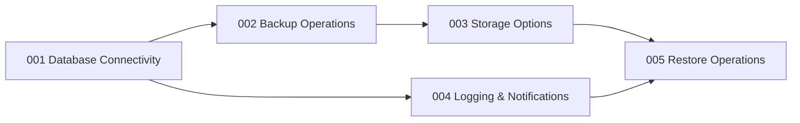

# Roadmap

Secuencia y estado de desarrollo de las features del proyecto. Cada feature sigue el ciclo
**Spec-Driven Development**: `spec.md` (qué), `plan.md` (cómo), `tasks.md` (tareas verificables)
y un **commit** propio con su documentación operativa en `docs/`.

## Leyenda de estado

- 🔴 **Pendiente** — No iniciada.
- 🟡 **En desarrollo** — En implementación activa.
- 🟢 **Completada** — Implementada, probada y comprometida con su commit.

| # | Feature | Alcance | Prioridad | Estado | Commit | Documento |
|---|---------|---------|-----------|--------|--------|-----------|
| 001 | [Database Connectivity](spec/features/001-database-connectivity/spec.md) | Soporte MySQL, PostgreSQL, MongoDB, SQLite; testeo y manejo de errores de conexión | Alta | 🟢 Completada | `feat(001)` | [docs/001](docs/001-database-connectivity.md) |
| 002 | [Backup Operations](spec/features/002-backup-operations/spec.md) | Backup full/incremental/diferencial, compresión gzip/tar, rendimiento | Alta | 🟢 Completada | `feat(002)` | [docs/002](docs/002-backup-operations.md) |
| 003 | [Storage Options](spec/features/003-storage-options/spec.md) | Almacenamiento local + AWS S3, Google Cloud Storage, Azure Blob | Alta | 🟢 Completada | `feat(003)` | [docs/003](docs/003-storage-options.md) |
| 004 | [Logging & Notifications](spec/features/004-logging-and-notifications/spec.md) | Logs detallados, notificaciones Slack | Media | 🟢 Completada | `feat(004)` | [docs/004](docs/004-logging-and-notifications.md) |
| 005 | [Restore Operations](spec/features/005-restore-operations/spec.md) | Restauración completa y selectiva | Alta | 🟢 Completada | `feat(005)` | [docs/005](docs/005-restore-operations.md) |

## Dependencias entre features

- `001` es prerrequisito de todas: sin conexión validada no hay backup, restore ni logging fiable.
- `002` depende de `001` (usa la conexión para armar los comandos de volcado).
- `003` es ortogonal a `002` pero se integra en el final del pipeline de backup y en el inicio del restore.
- `004` envuelve las operaciones de `001`–`003` para medir tiempos y notificar.
- `005` cierra el ciclo de vida: consume el artefacto producido por `002` y recuperado por `003`.

## Hitos de entrega

| Hito | Contenido | Criterio de salida |
|------|-----------|--------------------|
| M0 — Scaffold | Constitution, package.json, README, base de `src/consts`, `src/utils`, scripts | `npm test` y `npm run lint` pasan; `npm run build` valida sintaxis. |
| M1 — Conectividad | Feature 001 + `dbu test-connection` | El comando valida credenciales contra cada motor y devuelve códigos de error claros. |
| M2 — Backup | Feature 002 + `dbu backup` | Genera artefacto comprimido localmente con duración y estado registrados. |
| M3 — Almacenamiento | Feature 003 + `--storage` y `dbu list-backups` | Artefactos subidos a local/S3/GCS/Azure y listados. |
| M4 — Observabilidad | Feature 004 + log file y Slack | Todo evento queda en JSONL y las notificaciones Slack opcionales funcionan. |
| M5 — Restauración | Feature 005 + `dbu restore` | Restauración completa y selectiva desde local y nube. |
| M6 — Empaquetado | `npm run package` | `database-backup-utility-spec.zip` generado con toda la estructura. |

## Estado actual

El proyecto se encuentra en el **hito M6**: todas las features están completadas y documentadas.
Cada feature dispone de su commit individual y de su documentación de rollback en `docs/`.